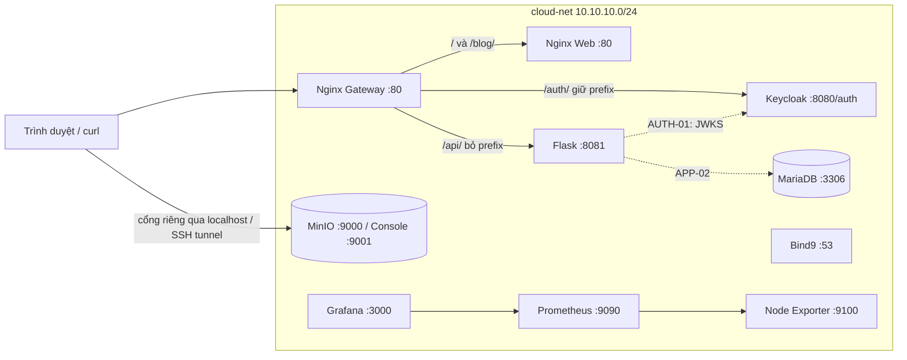

# Kiến trúc và hợp đồng tích hợp

## Sơ đồ

Bộ [5 sơ đồ Archify tương tác](diagrams/index.html) gồm tổng thể local, triển khai Docker, JWT mục tiêu, giám sát và load balancing mục tiêu. Xem [ghi chú nguồn và cách tái tạo](diagrams/README.md) để phân biệt cấu hình hiện tại với phần mở rộng dự kiến.

Nét đứt là tích hợp còn TODO. DNS Bind9 phục vụ zone riêng; Docker embedded DNS `127.0.0.11` tiếp tục phân giải tên service. Scaffold chưa cấu hình mọi container tự dùng Bind9: muốn gọi `*.cloud.local`, truyền resolver rõ ràng hoặc thiết kế forwarder trước khi đổi `dns:`. Zone `.local` được giữ theo đề, có thể xung đột mDNS trên host; dùng `dig @...` để kiểm chứng.

## Danh mục IP

| Service | IP | Cổng container |
|---|---|---|
| web-frontend-server | 10.10.10.10 | 80; 8082 stub_status nội bộ |
| application-backend-server | 10.10.10.20 | 8081 |
| relational-database-server | 10.10.10.21 | 3306 |
| authentication-identity-server | 10.10.10.30 | 8080, context /auth |
| object-storage-server | 10.10.10.40 | 9000 S3, 9001 Console |
| internal-dns-server | 10.10.10.53 | 53 TCP/UDP |
| monitoring-prometheus-server | 10.10.10.60 | 9090 |
| monitoring-node-exporter-server | 10.10.10.61 | 9100 |
| monitoring-grafana-dashboard-server | 10.10.10.70 | 3000 |
| api-gateway-proxy-server | 10.10.10.80 | 80 |
| Dự kiến web thứ hai / web exporter | .11 / .62 | 80 / 9113; chưa tạo |

IP tĩnh dùng để bản ghi DNS của bài lab trỏ đúng container. Các kết nối ứng dụng vẫn dùng **tên service**, không hardcode IP. Một vai trò monitoring có Node Exporter hỗ trợ; thêm web exporter và bản sao web sẽ tăng số container lên 12 nhưng vẫn giữ 9 vai trò.

## Hợp đồng HTTP

| URL gateway | URL upstream | Kết quả nghiệm thu |
|---|---|---|
| `/` | web `/` | HTML 200 |
| `/blog/` | web `/blog/` | HTML 200 |
| `/api/hello` | app `/hello` | 200, `{"message":"Hello from App Server!"}` |
| `/api/student` | app `/student` | 200, mảng JSON 5 sinh viên; TODO APP-01 |
| `/api/students-db` | app `/students-db` | 200, dữ liệu studentdb; TODO APP-02 |
| `/api/secure` | app `/secure` | token hợp lệ 200; thiếu/sai/hết hạn 401; TODO AUTH-01 |
| `/auth/…` | Keycloak `/auth/…` | discovery/login đúng URL canonical |
| `/student/` | app `/student` | cùng dữ liệu /api/student; TODO GW-01 |

`/health` trên API là liveness: 200 chỉ xác nhận process API đang phục vụ, chưa chứng minh kết nối DB hoặc OIDC. Các endpoint TODO ban đầu trả 501.

## Hợp đồng dữ liệu

`students.json`: mảng **5** object, trường `id` là số nguyên, `name` và `major` là chuỗi, `gpa` là số. Chọn một thang GPA thống nhất và ghi rõ trong bài. Chưa điền dữ liệu ở scaffold.

`studentdb.students`: `id INT PRIMARY KEY AUTO_INCREMENT`, `student_id VARCHAR(10)`, `fullname VARCHAR(100)`, `dob DATE`, `major VARCHAR(50)`; ít nhất **3** dòng. API `/students-db` trả tên cột này; chuyển `dob` thành chuỗi ISO `YYYY-MM-DD` trước khi JSON hóa. Schema này khác danh sách JSON; không tự đổi tên cột nếu chưa cập nhật hợp đồng.

Ứng dụng dùng user `DB_USER`, không dùng root. Migration cấp SELECT trên `studentdb.students` cho user đó. `DB_NAME=minicloud` là DB nền cho notes; `STUDENT_DB_NAME=studentdb` dành cho phần mở rộng. Nếu đổi `DB_NAME`, sửa cả SQL init.

## Hợp đồng OIDC

- Realm: `realm_<STUDENT_ID>`; client/audience: `flask-app`; user: `sv01`, `sv02`.
- `OIDC_ISSUER`: URL public qua gateway, ví dụ `http://localhost/auth/realms/realm_12345678`.
- `OIDC_JWKS_URL`: URL mạng nội bộ tới Keycloak để backend lấy khóa; không dùng `localhost` trong container.
- JWT phải xác minh **chữ ký RS256 + issuer + audience + expiration**. Thêm audience mapper `flask-app` trên Keycloak; `azp` không thay cho kiểm tra `aud`.
- Dùng public issuer thống nhất dù backend tải JWKS qua URL riêng. Khi chuyển EC2, đổi `PUBLIC_BASE_URL`, recreate auth/app, lấy token mới.

Keycloak có `KC_HTTP_RELATIVE_PATH=/auth`, gateway giữ nguyên prefix. Cách này theo [hướng dẫn reverse proxy của Keycloak](https://www.keycloak.org/server/reverseproxy). Cổng 8081 dành cho kiểm tra trực tiếp; giao diện sẽ dùng URL canonical ở cổng gateway.

## Giới hạn quan sát

Node Exporter cung cấp số liệu máy Linux, không tự cung cấp CPU/RAM từng container. Network mặc định thuộc namespace container exporter vì bài yêu cầu chung `cloud-net`; ghi rõ giới hạn khi thuyết trình. Muốn metrics network host chính xác trên EC2, thiết kế lại exporter dùng host network hoặc bổ sung collector phù hợp; metrics từng container cần cAdvisor hoặc giải pháp khác. Không gọi `node_*` là số liệu từng service.

Grafana hiển thị metrics từ Prometheus, đáp ứng lựa chọn visualization trong đề. Log hiện qua `docker compose logs`; nếu muốn dashboard log, cần thêm Loki/agent, ngoài nền này.

## Nguồn kỹ thuật đã đối chiếu

- [Keycloak hostname](https://www.keycloak.org/server/hostname).
- [ISC BIND9 image và cấu hình](https://hub.docker.com/r/internetsystemsconsortium/bind9): chọn nhánh 9.20 thay nhánh 9.18 trong DOCX.
- [NGINX Prometheus Exporter](https://github.com/nginx/nginx-prometheus-exporter): chuyển stub_status thành Prometheus metrics.
- [Node Exporter Docker](https://github.com/prometheus/node_exporter#docker): host mounts và giới hạn container.
- [Grafana provisioning](https://grafana.com/docs/grafana/latest/administration/provisioning/): datasource và dashboard từ file.
- [Compose merge rules](https://docs.docker.com/reference/compose-file/merge/): override mount theo cùng target trong container.
- [MinIO releases](https://github.com/minio/minio/releases/tag/RELEASE.2025-04-22T22-12-26Z): phiên bản lab được ghim để demo Console theo đề.
